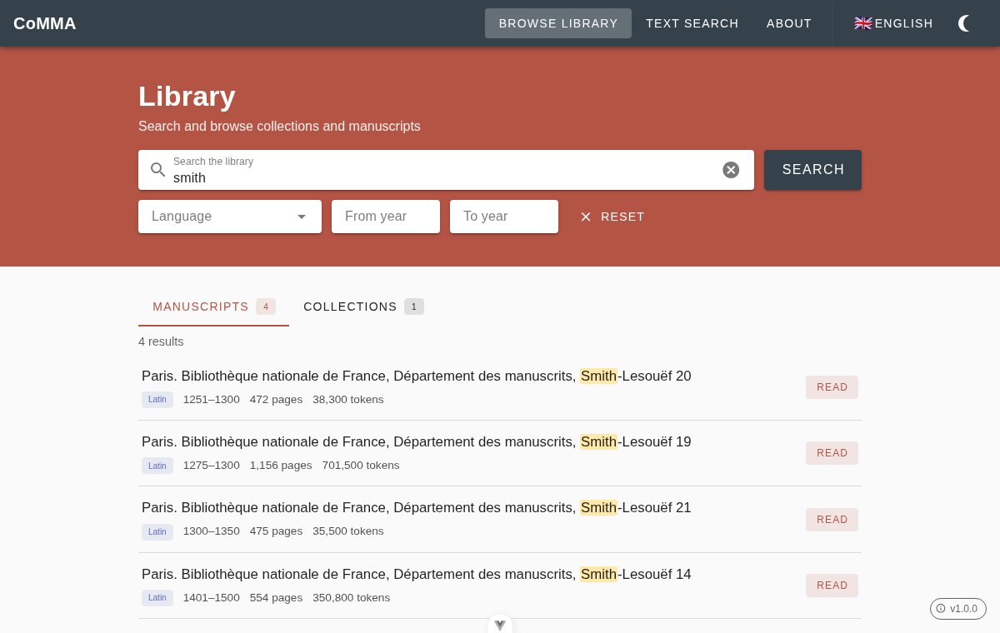
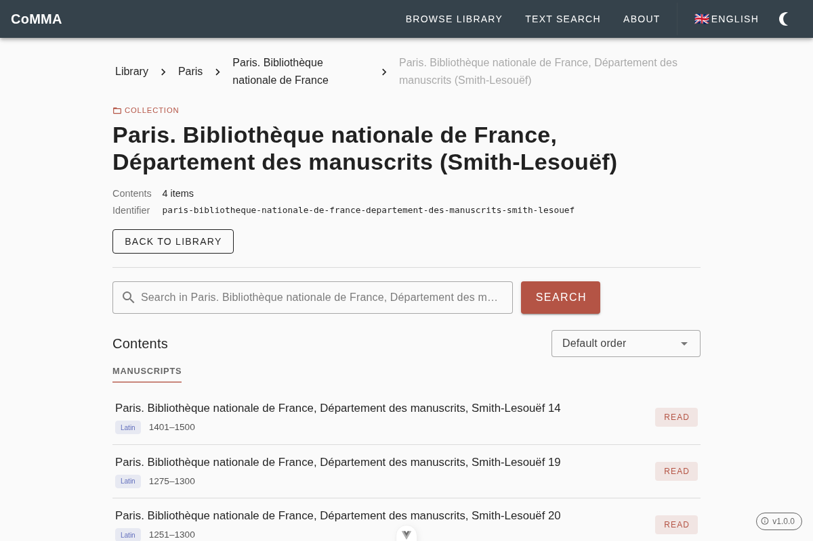
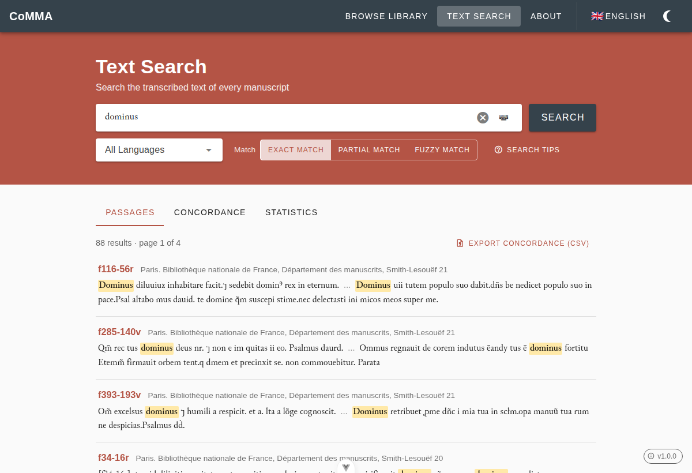
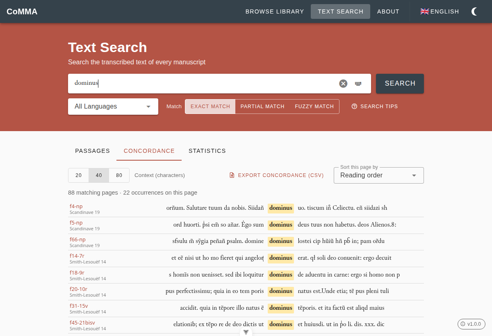
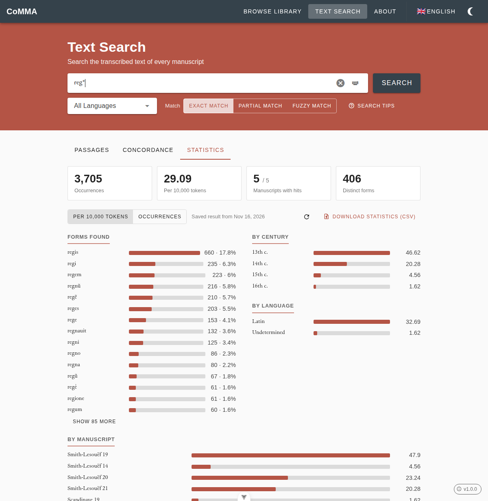

# TexTile

[](https://github.com/cllg-project/TexTile/actions/workflows/tests.yml)

The web reader for **CoMMA**, *a Large-scale Corpus of Multilingual Medieval Archives*: browse the library,
search the transcribed text of medieval manuscripts, read them next to their images, and study how a word is
used with concordances and frequency statistics. English and French.

A single-page application (Vue 3 and Vuetify 3) that talks to the
[TexTile API](https://github.com/cllg-project/TexTile-Backend).



**Contents**
[A tour](#a-tour) ·
[Quick start](#quick-start) ·
[Configuration](#configuration) ·
[Scripts](#scripts) ·
[How it talks to the API](#how-it-talks-to-the-api) ·
[Addresses](#addresses-and-shareable-links) ·
[Project layout](#project-layout) ·
[Translations](#translations) ·
[Deployment](#deployment) ·
[Quality](#quality) ·
[Upgrading](#upgrading)

## A tour

### Library

Search manuscripts and collections with a normal search form (not a typeahead): by title, shelfmark, publisher,
language or date, with filters for language and years. Accents and case are ignored, every word has to match,
and short numbers match longer ones (`19` finds *Smith-Lesouëf 19* first). Manuscripts and collections have
their own paginated tabs. With no query, the library shows its top-level collections.

### Collections

Every collection has its own page: breadcrumbs, its sub-collections, a paginated and sortable list of its
manuscripts, and a search box that searches **inside** that collection and everything below it. A collection
with ten thousand manuscripts still loads only the twenty on the current page.



### Text search

Search the transcribed text of every manuscript, with exact, partial or fuzzy matching, phrases (`"la bouche"`),
alternatives (`deus,deum`) and wildcards (`reg*`), and a virtual keyboard for medieval characters. The same
search has three views:

| Passages | Concordance | Statistics |
|---|---|---|
|  |  |  |

- **Passages**: the pages where the words occur, with the matches highlighted.
- **Concordance**: every occurrence with its left and right context, in reading order, aligned on the keyword.
  Choose the width of the context, sort the page by the left or right context, and export all of it as a CSV.
- **Statistics**: how often the words occur, overall and per 10,000 tokens, which forms matched (what a
  wildcard such as `reg*` really found), and how they are spread over manuscripts, centuries and languages.
  The server counts while you watch: a loading indicator shows how far it is and the figures fill in as they
  arrive. Finished results are saved, and can be downloaded as a CSV.

### Reader

Read a manuscript page by page next to its images (an [IIIF](https://iiif.io) viewer, [Tify](https://github.com/tify-iiif-viewer/tify))
kept in sync with the passage. Jump to a page, search inside the document, change the display, download the
TEI, cite it. Everything that can be shared has an address, so a search or a page can be sent as a link.

### Also

Light and dark themes, English and French (remembered by the browser), and layouts for phones.

## Quick start

You need **Node.js** `^20.19.0 || >=22.12.0` and a running **TexTile API** (see the
[backend README](https://github.com/cllg-project/TexTile-Backend#quick-start), which starts one with example data).

```bash
cp .env.example dts-ui/.env        # then check the API address in it
cd dts-ui
npm ci
npm run dev                        # http://localhost:5173
```

The API must allow this address in its `ALLOWED_ORIGINS` (`http://localhost:5173` is the default).

## Configuration

One setting, in `dts-ui/.env` (or in the environment of the build):

```ini
VITE_DTS_BASE_URL=http://localhost:5000
```

It is the public address of the API, path prefix included, for example `https://example.org/dts`: the same as the
backend's `PUBLIC_BASE_URL`. A trailing slash is fine. It is read **when the application is built**, so rebuild
after changing it.

## Scripts

Run them in `dts-ui/`.

| Command | What it does |
|---|---|
| `npm run dev` | development server with hot reload |
| `npm run build` | production build in `dist/` |
| `npm run preview` | serve the production build locally |
| `npx eslint .` | check the code (what CI runs) |
| `npm run lint` | the same, but **rewrites files** to fix what it can (`--fix`) |
| `npm run format` | format `src/` with Prettier |

## How it talks to the API

All requests are in `dts-ui/src/api/dts.js`.

| Function | API endpoint | Used by |
|---|---|---|
| `fetchRootCollection`, `fetchCollectionRaw` | `/collection/` (DTS, paginated) | library, collection pages |
| `searchCatalogManuscripts` | `/manuscripts/` | library, search inside a collection |
| `searchCatalogCollections` | `/collections/search/` | the same |
| `fetchCatalogFacets` | `/manuscripts/facets/` | the library's language and year filters |
| `searchAll` | `/search/` | text search, passages |
| `fetchConcordance`, `concordanceUrl` | `/concordance/` (JSON, CSV) | the concordance tab and its export |
| `streamTermStats`, `termStatsCsvUrl` | `/concordance/stats/` (streamed NDJSON, CSV) | the statistics tab |
| `fetchNavigation`, `fetchPage`, `fetchDocumentXml` | `/navigation/`, `/document/` (DTS) | the reader |

## Addresses and shareable links

The state of each page is in its address, so the back button and shared links work.

| Page | Address | Parameters |
|---|---|---|
| Library | `/catalog` | `q`, `lang`, `from`, `to`, `tab` (`manuscripts` or `collections`), `mp` / `cp` / `bp` (page), `sort` |
| Collection | `/collection/:id` | `page`, `sort`, `q`, `tab` |
| Text search | `/search` | `q`, `mode` (`exact`, `partial`, `fuzzy`), `language`, `page`, `view` (`results`, `concordance`, `stats`) |
| Reader | `/doc/:resource` and `/doc/:resource/p/:ref` | `highlight` (the words to highlight) |
| About, project | `/homepage`, `/about` | |

Identifiers in addresses are URL-encoded (`/doc/https%3A%2F%2Fdata.example.org%2Fentity%2FQ1`).

## Project layout

```
dts-ui/
  index.html              loads the Tify viewer, and a Matomo snippet (see Deployment)
  src/
    main.js, App.vue      start-up, the app bar
    router/index.js       the routes (loaded on demand)
    views/                one file per page: Catalog, Collection, SearchView, DocumentView, About, ProjectInfo
    components/           ManuscriptRow, CollectionCard, ConcordanceTable, TermStats, BarList, CatmusKeyboard, AppBar
    api/dts.js            every request to the API
    lib/                  helpers: language names, result formatting, preferences
    locales/en.js, fr.js  the texts of the interface
    i18n.js               language set-up and persistence
    config/urls.js        project links and the citation
    plugins/vuetify.js    theme (colours, light and dark)
docs/screenshots/         the images of this README
```

## Translations

All the texts of the interface are in `dts-ui/src/locales/en.js` and `fr.js`, grouped by page (`browse` for the
library and collections, `search` for the text search, `document` for the reader...). Add a key to **both**
files and use it with `$t('browse.title')`; plurals take the number: `$t('browse.items', { count }, n)`.
The chosen language is kept in the browser.

## Deployment

The result of `npm run build` is a folder of static files (`dts-ui/dist/`). Any static host will do, if:

- **It serves `index.html` for every unknown path** (`/catalog`, `/collection/…`, `/doc/…`, `/search`): the
  application does its own routing.
- **It is served from the root of its domain.** For a sub-path, set `base` in `vite.config.js` first.
- **`index.html` is cached only briefly.** The other files have a hash in their name and can be cached for a long
  time, but `index.html` is what names them, so a stale one points to files that no longer exist.
- **The API accepts its origin**, exactly (scheme, host and port), in `ALLOWED_ORIGINS`.
- **`VITE_DTS_BASE_URL` was set at build time** to the API's public address.

Things to know before you host your own copy:

- The reader's image viewer (Tify 0.31) is loaded from a public CDN, in `index.html`. Self-host it if your
  visitors cannot reach the CDN or your policy forbids it.
- `index.html` also contains a **Matomo** snippet (cookies disabled) that sends page views to the Inria
  instance. Remove it, or point it at your own, for a deployment of your own.
- The links to the project, the paper and the citation are in `dts-ui/src/config/urls.js`.

## Quality

CI (`.github/workflows/tests.yml`) installs the dependencies, runs ESLint and builds, on every push and pull
request. There are no unit tests for the interface yet; the API has its own (220+) in its repository.

## Upgrading

Moving from an earlier version: see [MIGRATION.md](MIGRATION.md). Upgrade the API first.

## Citing

> Clérice, T., Gabay, S., Vlachou-Efstathiou, M., Pinche, A., Sagot, B. (2026).
> *CoMMA, a Large-scale Corpus of Multilingual Medieval Archives.* LREC 2026, Palma de Mallorca.
> <https://inria.hal.science/hal-05299220>

## Related projects

- [TexTile API](https://github.com/cllg-project/TexTile-Backend): the backend of this interface.
- [MyDapytains](https://github.com/distributed-text-services/MyDapytains) and the [DTS specification](https://dtsapi.org).
- [Kraken](https://github.com/mittagessen/kraken): an OCR/HTR engine for manuscripts.

## License

MIT, © 2025 Inria. See [LICENSE](LICENSE).
